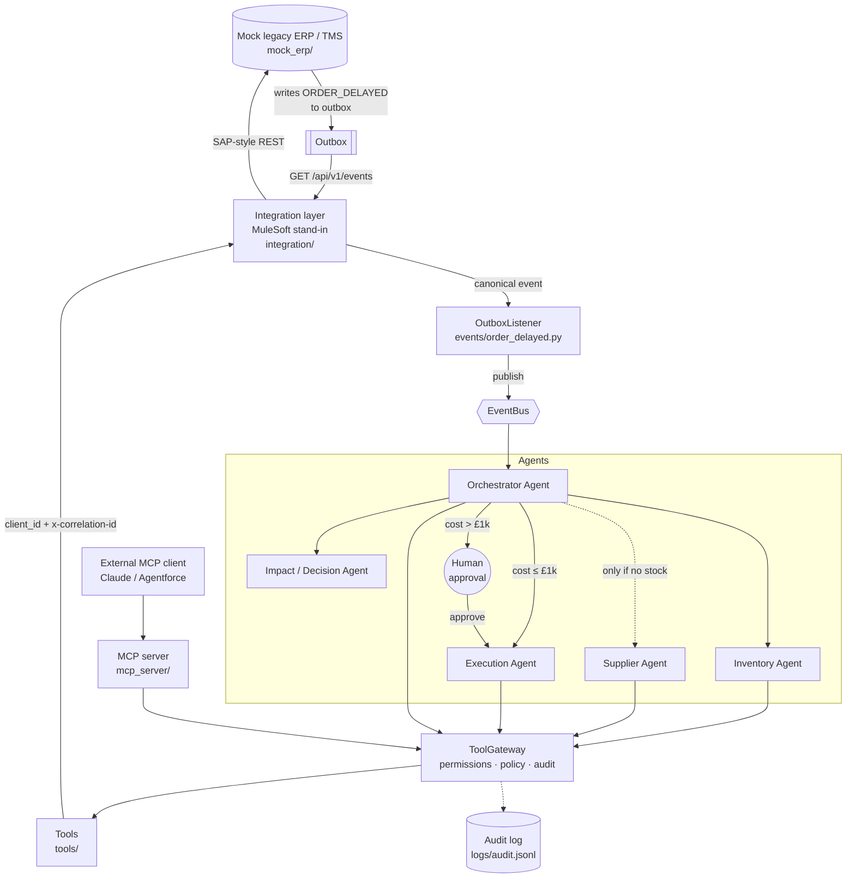

# Multi-Agent Supply Chain Exception Orchestrator

An ERP publishes `ORDER_DELAYED` → a team of specialist agents investigates, weighs the options and either fixes the order autonomously or asks a human to approve. Then the ERP is updated and operations are notified.

Every agent action goes through least-privilege tools, an integration layer (MuleSoft stand-in), and an audit log.

```text
━━━ ERP: carrier reports order #1842 will be 4 day(s) late ━━━
20:47:23  Orchestrator       ORDER_DELAYED received from ERP: order #1842 4 days late (Port congestion at Felixstowe)
20:47:23  Orchestrator       called get_order(order_id='1842')
20:47:23  Orchestrator       Context: 400 x SKU-4471 for Northwind Retail (PLATINUM), promised in 2 day(s)
20:47:23  Inventory Agent    called check_inventory(sku='SKU-4471')
20:47:23  Inventory Agent    Result: 420 units of SKU-4471 in WH-B (Birmingham DC), need 400
20:47:23  Orchestrator       Viable stock found -> skipping Supplier Agent
20:47:23  Decision Agent       option REROUTE_WAREHOUSE     WH-B        cost £ 2,400  late 0d  score 2,400
20:47:23  Decision Agent       option WAIT                  -           cost £     0  late 4d  score 6,000
20:47:23  Decision Agent     Recommended REROUTE_WAREHOUSE (WH-B): ... Additional cost: £2,400 ...
20:47:23  Orchestrator       Cost £2,400 > £1,000 threshold -> pausing for human approval

┌─ HUMAN APPROVAL REQUIRED (APR-6BB991) ──────────────────────────────
│ Agent recommendation: REROUTE_WAREHOUSE WH-B
│ Additional cost: £2,400
└──────────────────────────────────────────────────────────────────────
APPROVE / REJECT? [a/r] a
20:47:31  human:ops.manager  approved APR-6BB991
20:47:31  Execution Agent    called update_order(order_id='1842', action='REROUTE_WAREHOUSE', extra_cost_gbp=2400, approval_id='APR-6BB991')
20:47:31  Execution Agent    called send_operations_message(...)
20:47:31  Orchestrator       Workflow complete: REROUTE_WAREHOUSE via WH-B (£2,400)
```

---

## Problem

When a shipment slips, an operations analyst has to do the same work every time. They look up the order and the customer's tier. They check whether another warehouse has stock. If none does, they look for an alternative supplier. Then they weigh extra cost against late-delivery penalties, get sign-off if the fix is expensive, update the ERP and tell the team.

That is a good fit for agents. The investigation is multi-step and conditional, it spans several legacy systems, and the most expensive decisions need a human.

## Architecture



Layer by layer:

| Layer | Where | Role |
|---|---|---|
| Event source | `mock_erp/api.py` | Legacy ERP/TMS. A carrier delay writes an `ORDER_DELAYED` event to its **transactional outbox**. |
| Event delivery | `events/order_delayed.py` | `OutboxListener` polls the event API and publishes onto an `EventBus`. The seam for Kafka, Anypoint MQ or Salesforce Platform Events. |
| Agents | `agents/` | Orchestrator and four specialists. |
| Governance | `governance/` | Role permissions, approval policy, approval tickets, audit trail. |
| MCP | `mcp_server/server.py` | Exposes the same tools to any MCP client, under the same governance. |
| Tools | `tools/` | Thin typed functions. They only know the integration layer. |
| Integration | `integration/`, `mulesoft/` | System/Process/Event APIs, canonical model, client-id policy, correlation IDs. Contract in `order-system-api.raml`. Two interchangeable implementations: a Python stand-in and a real Mule 4 app. |
| System of record | `mock_erp/` | In-memory ERP seeded from `data.json`. |

## Agents

| Agent | Does | Tools allowed |
|---|---|---|
| **Orchestrator** (`orchestrator.py`) | Receives the event, loads context and decides which agents run and in what order. It pauses for approval and resumes afterwards. | `get_order`, `get_shipment` |
| **Inventory Agent** (`inventory_agent.py`) | Finds another warehouse that can cover the full quantity. | `check_inventory` |
| **Supplier Agent** (`supplier_agent.py`) | Runs **only if no warehouse can cover the order**. Finds suppliers with enough units. | `find_alternative_supplier` |
| **Impact / Decision Agent** (`decision_agent.py`, `llm_reasoner.py`) | Scores WAIT / REROUTE / ALT SUPPLIER; Claude picks one and explains it (rules if Claude is unavailable). | **none** (it recommends, it never acts) |
| **Execution Agent** (`execution_agent.py`) | The only writer. Updates the ERP and notifies ops. | `update_order` (policy-gated), `send_operations_message` |

**Conditional orchestration:**

```text
delay detected → get order + shipment
  → Inventory Agent
  → no viable stock?  → Supplier Agent
  → Decision Agent
  → cost > threshold
    or Claude overrode
    the lowest score? → request human approval (workflow pauses)
  → WAIT?             → record + notify, done
  → otherwise         → Execution Agent
```

**Decision model**, kept transparent so an approver can check the numbers:

```text
score = extra_cost + days_late × late_penalty_per_day[customer_tier]
days_late (mitigation) = max(0, lead_or_transit_days − days_until_promised_date)
days_late (wait)       = reported delay
```

Penalties per tier (PLATINUM £1,500/day, GOLD £600, STANDARD £150) are set in `settings.py`.

**Claude in the loop.** The scorer prices every option; then Claude (`claude-opus-5-5`, structured output) reads the order, the delay and the scored options, picks one *by index* and writes the rationale an ops manager sees. The design keeps the LLM inside guardrails:

- **It can only choose, not invent.** The answer is validated against the scored list; costs come from the scorer, never from the model.
- **It can't approve.** The approval threshold is applied in code after the choice. If Claude picks anything other than the lowest score, the run **always** goes to a human (`LLM_OVERRIDE` in the audit log).
- **It fails safe.** API errors, refusals or an invalid answer log `LLM_FALLBACK` and the rule-based choice is used, so the workflow never stalls on the model.
- Each recommendation records `decided_by` (`rules` or the model id).

| `DECISION_MODE` | Behaviour |
|---|---|
| `auto` (default) | Claude if `ANTHROPIC_API_KEY` is set, otherwise rules |
| `llm` | Always try Claude (falls back to rules on error) |
| `rules` | Never call Claude: fully deterministic |

`LLM_MODEL` overrides the model. Example output for order #1842:

> Reroute the 400 pump assemblies from the Birmingham DC (WH-B) for an extra £2,400 so Northwind Retail still receives them by the 16 October promise date. Waiting out the carrier delay would land the order 4 days late and cost about £6,000 in Platinum late penalties. Missing a date only two days away would also strain a top-tier relationship.

### Demo scenarios (`data.json`)

| Order | Situation | Path | Outcome |
|---|---|---|---|
| **#1842** | PLATINUM, 4 days late, 420 units in Birmingham | Inventory → Decision | Reroute **£2,400 → human approval** |
| **#1843** | GOLD, 6 days late, no warehouse stock | Inventory → **Supplier** → Decision | Supplier B **£1,800 → human approval** |
| **#1844** | GOLD, 3 days late, stock in Glasgow | Inventory → Decision → Execution | Reroute £350, **autonomous** |
| **#1845** | STANDARD, 1 day late | Inventory → Decision → Execution | **WAIT**. A reroute would cost more than the late penalty. |

## Tools

| Tool | Integration endpoint |
|---|---|
| `get_order(order_id)` | `GET /api/v1/system/orders/{id}` |
| `get_shipment(order_id)` | `GET /api/v1/system/shipments/{id}` |
| `check_inventory(sku)` | `GET /api/v1/system/inventory/{sku}` |
| `find_alternative_supplier(sku)` | `GET /api/v1/system/suppliers/{sku}` |
| `update_order(order_id, action, …)` | `POST /api/v1/system/orders/{id}/actions` |
| `send_operations_message(message)` | `POST /api/v1/system/notifications` |

Example: `find_alternative_supplier("SKU-9020")` returns

```json
{"supplier_id": "V-200", "supplier": "Supplier B", "available_units": 500, "lead_time_days": 2, "extra_cost": 1800}
```

## MCP

`mcp_server/server.py` exposes all six tools over MCP. It works with the `mcp` Python SDK v1 (`FastMCP`) and v2 (`MCPServer`).

```bash
python -m mcp_server.server                                  # stdio
claude mcp add supply-chain -- python -m mcp_server.server   # use from Claude Code
```

The server advertises every tool, but **each call goes through the same `ToolGateway` as the internal agents**. The caller's role comes from `MCP_AGENT_ROLE` (default `MCP Client`, read-only). An external LLM that tries `update_order` gets this response:

```json
{"error": "PERMISSION_DENIED", "role": "MCP Client", "tool": "update_order", "reason": "not in role permissions"}
```

The folder is named `mcp_server/`, not `mcp/`, so it doesn't shadow the `mcp` SDK package.

## MuleSoft / API layer

Agents never call the ERP. The chain is:

```text
Agent → ToolGateway → tool → Integration layer (MuleSoft) → legacy ERP
```

`integration/api.py` plays the role of the Mule app:

- **API-led layers.** System APIs wrap ERP resources, a Process API composes them (`/process/orders/{id}/context`), and an Event API exposes the outbox.
- **Canonical model.** The ERP speaks SAP-style fields (`MATNR`, `WERKS`, `LABST`, `LIFNR`, `MENGE`). Agents see `sku`, `warehouse_id`, `available_units`, `supplier`, `quantity`. If the ERP is swapped or upgraded, only the mapping changes; the agents don't.
- **Policies.** Client-id enforcement (`client_id` / `client_secret` headers, 401 without them) and correlation-ID propagation. Each workflow's run ID flows all the way into the ERP action record.
- **Contract.** `integration/order-system-api.raml` is what you'd publish to Anypoint Exchange.

**Real MuleSoft.** `mulesoft/order-system-api/` is a Mule 4 app implementing the same RAML: the same flows, policies and mappings, written in Mule XML and DataWeave. Point `INTEGRATION_URL` at it and nothing else changes. All four demo scenarios give the same results through either implementation. Run it with Docker, with no MuleSoft account needed:

```bash
INTEGRATION_URL=http://mulesoft:8081 docker compose --profile mulesoft up --build
```

See [`mulesoft/README.md`](mulesoft/README.md) for Anypoint Code Builder and CloudHub.

## Human-in-the-loop

```text
extra cost ≤ £1,000  → Execution Agent acts on its own
extra cost > £1,000  → workflow pauses with an approval ticket → APPROVE / REJECT
     approve → update_order(…, approval_id) → ERP updated, ops notified
     reject  → order put ON HOLD, ops notified for manual handling
```

Change the threshold with `APPROVAL_THRESHOLD_GBP`. In the CLI you approve at a prompt. In the service you approve through REST (`POST /approvals/{id}/approve`), which is where a Slack button or a Salesforce approval process would plug in.

## Security / governance

**Least privilege per agent** (`governance/permissions.py`):

```text
Inventory Agent:  ✓ check_inventory              ✗ update_order
Decision Agent:   ✓ recommend (no tools at all)  ✗ execute anything
Execution Agent:  ✓ update_order                 only within policy: approval required above £1,000
MCP Client:       ✓ read-only tools              ✗ any write
```

**Policy is enforced at the tool boundary, not in the agent.** The Orchestrator asks for approval, but the `ToolGateway` is what actually blocks an unapproved £2,400 `update_order`. A buggy or prompt-injected agent still can't spend money. Approval tickets are **bound to one order, one action and one cost ceiling**. A ticket for "reroute #1842 for £2,400" can't be reused for #1843, for a different action or for £5,000, and it can only be decided once. All of this is covered by tests.

**Audit log.** Every event, tool call, result, denial, recommendation and human decision is written to `logs/audit.jsonl`, tagged with the run's correlation ID:

```json
{"actor": "Execution Agent", "event": "TOOL_DENIED", "summary": "✗ DENIED update_order(order_id='1842', action='REROUTE_WAREHOUSE', extra_cost_gbp=2400) - £2,400 exceeds £1,000 threshold; human approval required", "correlation_id": "RUN-1842-c55e", "ts": "..."}
```

## How to run

```bash
python -m venv .venv && source .venv/bin/activate
pip install -r requirements.txt
```

**1. One-command demo.** Everything runs in-process; no servers needed. Set `ANTHROPIC_API_KEY` to have Claude make the decisions; without it the rule-based scorer is used.

```bash
python run_demo.py                                  # #1842, you approve/reject at the prompt
python run_demo.py --scenario all --decision approve
python run_demo.py --scenario 1843 --decision reject
```

**2. As services.** This is the event-driven setup, with three containers mirroring the architecture.

```bash
export ANTHROPIC_API_KEY=sk-ant-...   # optional; passed through to the orchestrator container
docker compose up --build
# The ERP raises a delay. The workflow starts on its own: no user prompt involved.
curl -X POST localhost:8001/erp/shipments/1842/delay -H 'content-type: application/json' \
     -d '{"DELAY_D": 4, "RSN": "Port congestion"}'
curl localhost:8000/approvals                                   # pending approval
curl -X POST localhost:8000/approvals/<APR-ID>/approve -H 'content-type: application/json' \
     -d '{"approver": "ops.manager"}'
curl localhost:8000/runs                                        # workflow outcome
curl "localhost:8000/audit?run_id=<RUN-ID>"                     # audit trail
```

Without Docker, start the three services yourself:

```bash
uvicorn mock_erp.api:app --port 8001
ERP_URL=http://localhost:8001 uvicorn integration.api:app --port 8002
INTEGRATION_URL=http://localhost:8002 uvicorn service:app --port 8000
```

**3. Tests**

```bash
pytest
```

The suite covers workflow branches, the approval and rejection paths, permission denials, ticket reuse, the integration-layer contract, correlation-ID propagation and decision scoring, and the Claude guardrails (override → approval, fallback on error/refusal/invalid answer) using a fake client, so tests never call the API.

## Repo layout

```text
agents/          orchestrator, inventory, supplier, decision, execution agents
tools/           tool functions + registry + integration-layer client
integration/     MuleSoft stand-in (System/Process/Event APIs) + RAML contract
mulesoft/        real Mule 4 app implementing the same contract (+ Dockerfile)
mcp_server/      MCP server exposing the tools
mock_erp/        legacy ERP/TMS API + seed data
events/          ORDER_DELAYED schema, event bus, outbox listener
governance/      permissions + policy gateway, approval tickets, audit log
service.py       orchestrator as a service (event listener + approval API)
run_demo.py      CLI demo
settings.py      thresholds, penalties, service URLs
tests/
```

## Extending

- **More LLM agents.** The Supplier Agent could use Claude to weigh supplier reliability, or the Execution Agent could draft the customer email, each behind the same validate-then-gate pattern as the Decision Agent.
- **Real event bus.** Replace `EventBus`/`OutboxListener` with a Kafka consumer or a Salesforce Platform Event subscriber.
- **More exceptions.** Add `STOCKOUT` or `SUPPLIER_CANCELLED` as new event types with their own orchestration plans, reusing the same specialist agents.
